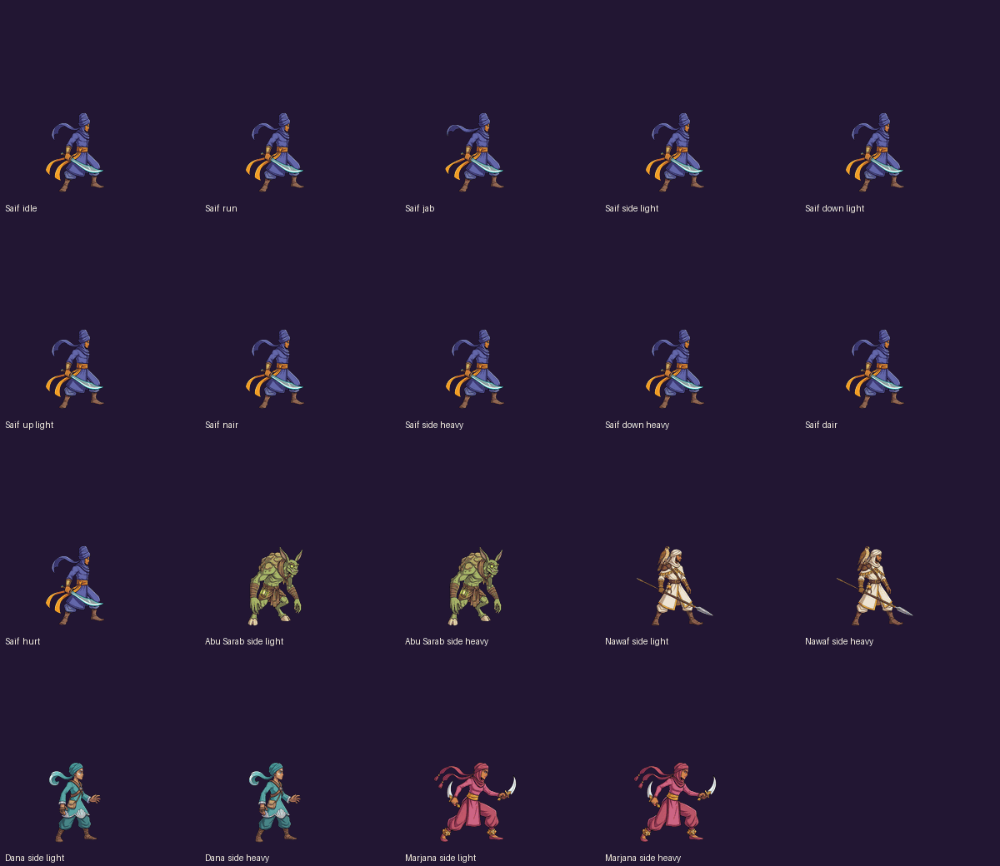

# Art status

## Pipeline (current)

Higgsfield's AutoSprite jobs failed every time on 23 Oct 2026: 9 attempts, each sat queued and then failed, with no credits charged. Until it works, animations come from video:

1. **Model sheet:** Nano Banana Pro, 16:9, 2k. Saif's sheet is the style reference for every other fighter.
2. **Base pose:** FLUX 3 from the sheet, then `remove_background`.
3. **Screen:** the cutout composited on flat `#00FF00`, or `#FF00FF` for green fighters (Abu Sarab), and uploaded.
4. **Animation:** Kling 3.0 with the screen pose as both start and end frame, 3 s, 1:1, std mode, sound off, 3.75 credits per clip. The prompt locks the camera, the side view and the weapon hand.
5. **Sprite sheet:** `python3 tools/video2sprite.py clip.mp4 name frames [cell] [--trim] [--magenta]` keys the screen, despills and trims the held frames. It places every sheet with the same 128 px ready-pose height and foot pivot, so all moves line up in game. Use a 384 px cell for big attacks.
6. **Review:** `python3 tools/preview_grid.py docs/art/animation-preview.gif`.

Retiming to frame data, hitboxes and the final WebP atlas are the editor's job (plan phase 2). The sheets here are its input.

## Sheets made

| Fighter | Done | Retake needed | Not started |
|---|---|---|---|
| Saif | idle, run, jab, side light, down light, up light, neutral air, side heavy, down heavy, down air, hurt | recovery (leaves the top of the frame) | jump, land, victory, taunt, Sand Stride |
| Abu Sarab | side light | side heavy (grab reaches the clip edge) | everything else |
| Nawaf | side light, side heavy | | everything else |
| Dana | side light, side heavy | | everything else |
| Marjana | side light | side heavy (daggers reach the clip edge) | everything else |

Weak spots to fix in retiming: Saif's run (the blade wobbles), the Ghoul's grab whiff turns away from the camera for 2 frames, and Marjana's spin blurs.

**Next fix:** shoot moves that travel (recovery, lunges, aerials) from a start frame with the fighter at about 60% size and extra margin, so nothing leaves the clip.

## Credits used

167.5 so far (1,118.74 to 951.24): stills about 66, 27 Kling clips 101.25, and 0 for the failed AutoSprite jobs.
